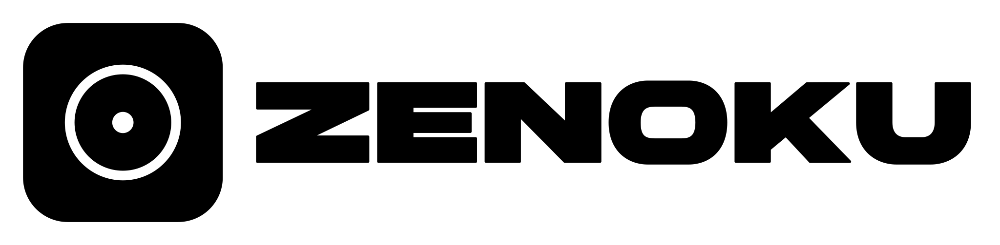
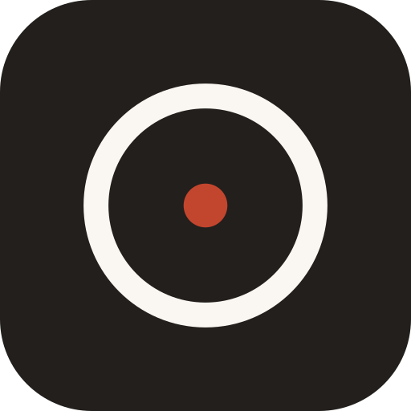
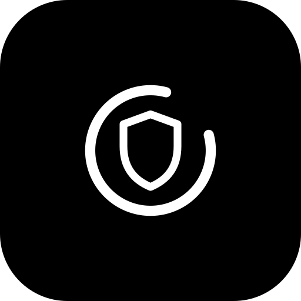
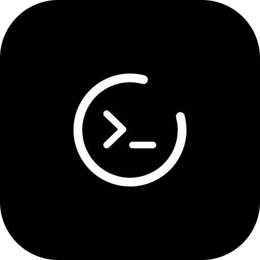
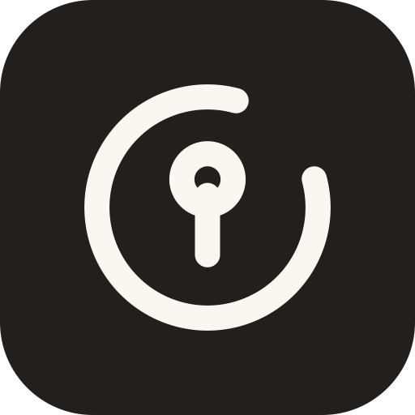
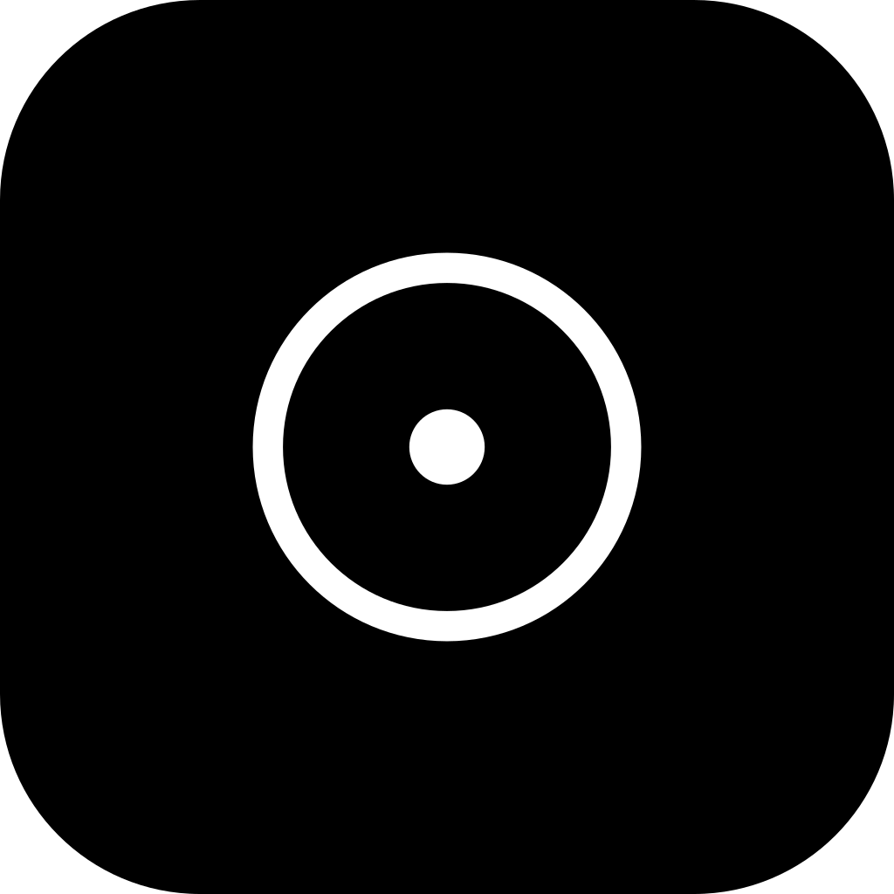
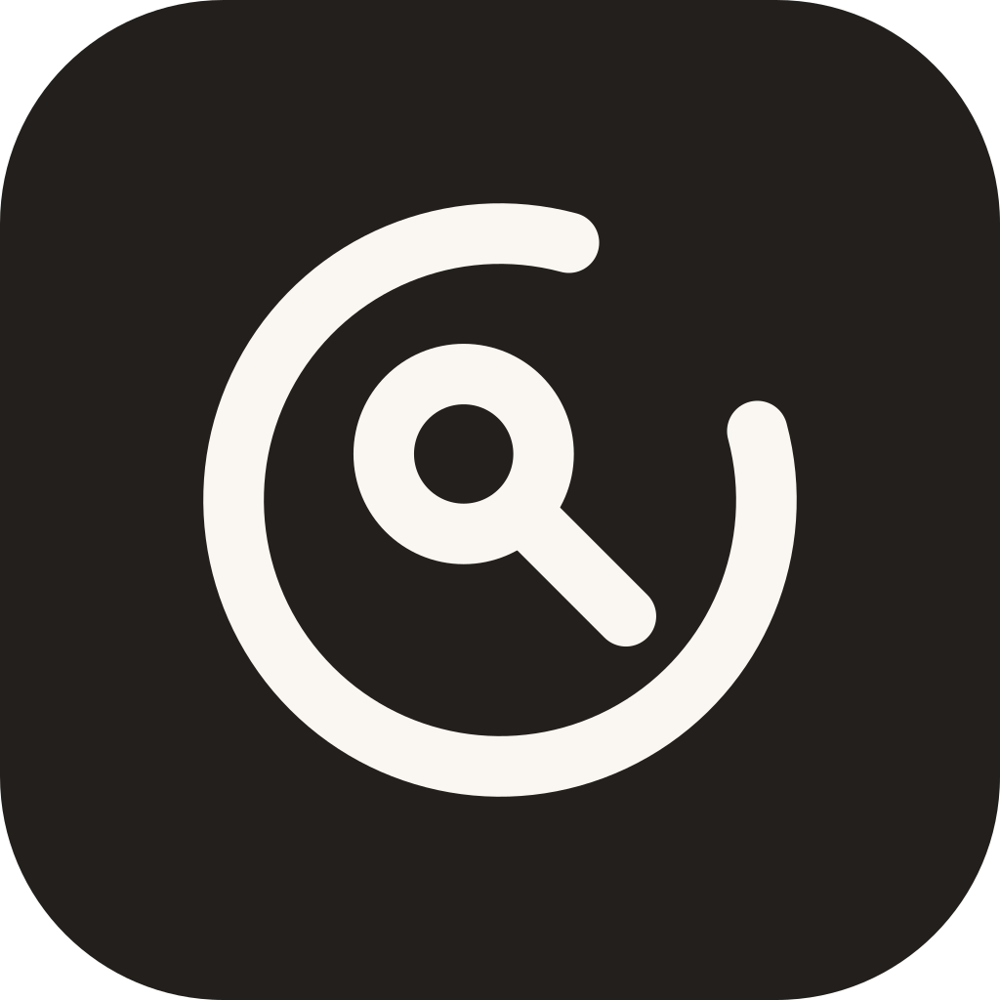
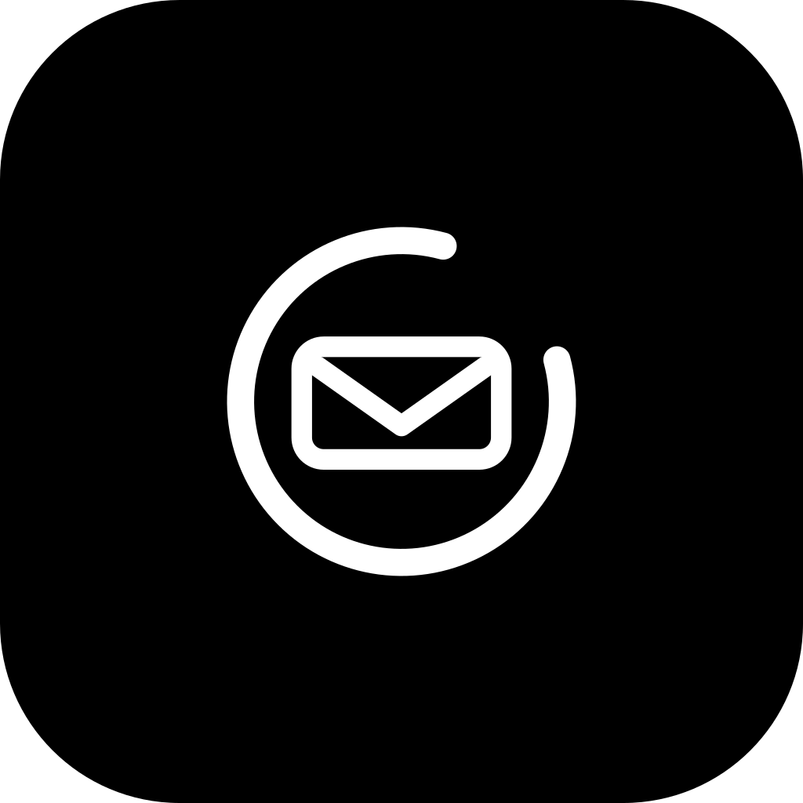
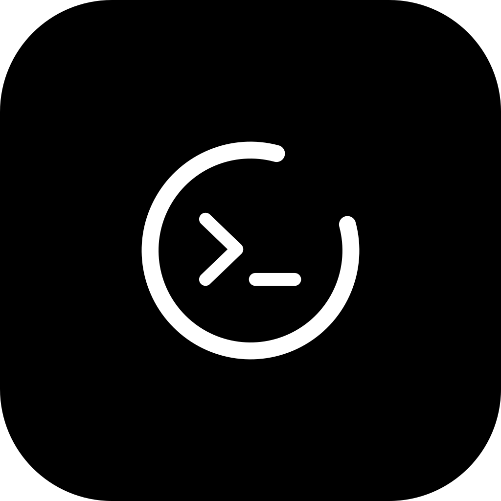
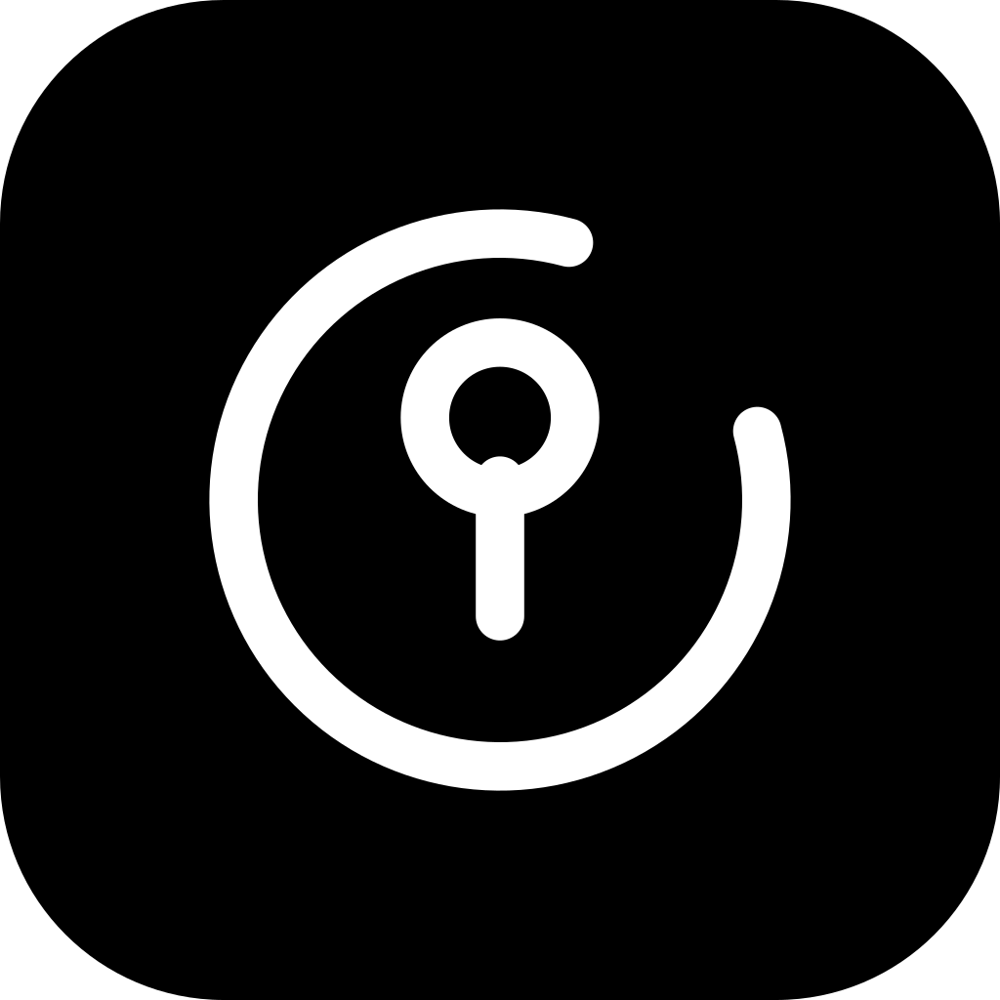

# zenoku-design

<p align="center">
  <picture>
    <source media="(prefers-color-scheme: dark)" srcset="assets/zenoku/readme-banner-dark.svg">
    
  </picture>
</p>

Бренд-ассеты и гайдлайны **zenoku** — общей крыши для домашней инфраструктуры и её инструментов.

| Знак | Проект | Что это |
|---|---|---|
|  | **zenoku** | зонтичный бренд (`zenoku.host`) |
|  | **[zeno](https://github.com/rival-afk/zeno)** | локальный «VirusTotal»: хэши по открытым базам, движки ClamAV / YARA-X |
|  | **[zent](https://github.com/rival-afk/zent)** | «Zenoku Post»: свой SMTP/POP3/IMAP на Rust, антиспам-нейронка |
|  | **[rsh](https://github.com/rival-afk/rsh)** | удалённая оболочка: SSH через auth → VPS → туннель → ПК |
|  | **[auth](https://github.com/rival-afk/auth)** | rival-auth: единая авторизация (API, PAM, SSH keys) |

## Галерея

Монохром: знаки только #000 на белом и #FFF на чёрном. Два цвета и больше ничего.

| | Знак | Лок-ап | Иконка |
|---|---|---|---|
| **zenoku** | <picture><source media="(prefers-color-scheme: dark)" srcset="assets/zenoku/mark-on-dark.svg"></picture> | <picture><source media="(prefers-color-scheme: dark)" srcset="assets/zenoku/logo-dark.svg"></picture> |  |
| **zeno** | <picture><source media="(prefers-color-scheme: dark)" srcset="assets/zeno/mark-on-dark.svg"></picture> | <picture><source media="(prefers-color-scheme: dark)" srcset="assets/zeno/logo-dark.svg"></picture> |  |
| **zent** | <picture><source media="(prefers-color-scheme: dark)" srcset="assets/zent/mark-on-dark.svg"></picture> | <picture><source media="(prefers-color-scheme: dark)" srcset="assets/zent/logo-dark.svg"></picture> |  |
| **rsh** | <picture><source media="(prefers-color-scheme: dark)" srcset="assets/rsh/mark-on-dark.svg"></picture> | <picture><source media="(prefers-color-scheme: dark)" srcset="assets/rsh/logo-dark.svg"></picture> |  |
| **auth** | <picture><source media="(prefers-color-scheme: dark)" srcset="assets/auth/mark-on-dark.svg"></picture> | <picture><source media="(prefers-color-scheme: dark)" srcset="assets/auth/logo-dark.svg"></picture> |  |

## Состав

```text
assets/<product>/
├── mark.svg           # чистый знак, #000, прозрачный фон
├── mark-on-dark.svg   # знак для тёмных фонов, #FFF
├── logo.svg           # горизонтальный лок-ап (знак + словесный знак)
├── logo-dark.svg      # лок-ап для тёмного фона
├── app-icon.svg       # иконка приложения: чёрный тайл 1024×1024
├── app-icon-paper.svg # иконка приложения: белый тайл
├── favicon.svg        # favicon: чёрный тайл 64×64
├── readme-banner.svg  # README-шапка: иконка слева, имя крупно (светлая тема)
├── readme-banner-dark.svg  # то же для тёмной темы
└── png/               # экспорт: mark 512/1024, logo 1600, icon 512/1024, favicon 16…512, readme-banner
```

продукты: `zenoku`, `zeno`, `zent`, `rsh`, `auth`.

## Бренд одним абзацем

Семейство знаков построено на одной дуге в 300° (разрыв 60° на северо-востоке, «вдох»)
и толщине штриха 4/64. **zenoku** — единственное исключение: полное кольцо и точка в центре,
целая система и её точка отсчёта. Остальные проекты — дуга и один глиф, производный от функции.
Двух цвета, монохром, никакого цвета. Подробности, сетка и правила — в [DESIGN.md](DESIGN.md).

## Использование

- Тёмная тема / светлый текст → `mark-on-dark.svg` / `logo-dark.svg`
- Светлая тема / чёрный текст → `mark.svg` / `logo.svg`
- Иконки приложений и favicons → `png/` или `app-icon.svg` / `favicon.svg`
- Шапка README → `readme-banner.svg` / `readme-banner-dark.svg` (готовые PNG в `png/readme-banner*.png`)
- Словесный знак — собственные кривые (производные от Brigends Expanded Regular, Multype Studio), визуально капс; файл шрифта в репо не входит

SVG полностью самодостаточны: wordmark — это кривые (paths), шрифт для рендера не нужен.

## Пересборка

```sh
./scripts/render.sh   # python3 + rsvg-convert; пересобирает SVG и все PNG
```

## Авторство и лицензия

Знаки и гайдлайны — MIT, см. [LICENSE](LICENSE).

Бренд-дирекшн выведен методом «direction → passes» из
[unslop](https://github.com/heydamir/unslop) Дамира Соколовского ([@heydamir](https://x.com/heydamir)),
CC BY 4.0 — отсылка, а не копирование текста.
