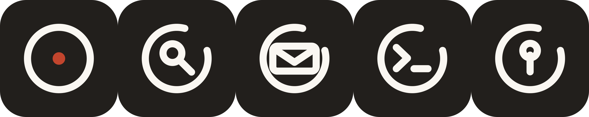

# zenoku-design

Бренд-ассеты и гайдлайны **zenoku** — общей крыши для домашней инфраструктуры и её инструментов:

| Знак | Проект | Что это |
|---|---|---|
|  | **zenoku** | зонтичный бренд (`zenoku.host`) |
|  | **[zeno](https://github.com/rival-afk/zeno)** | локальный «VirusTotal»: хэши по открытым базам, движки ClamAV / YARA-X |
|  | **zent** | «Zenoku Post»: свой SMTP/POP3/IMAP на Rust, антиспам-нейронка |
|  | **[rsh](https://github.com/rival-afk/rsh)** | удалённая оболочка: SSH через auth → VPS → туннель → ПК |
|  | **[auth](https://github.com/rival-afk/auth)** | rival-auth: единая авторизация (API, PAM, SSH keys) |



## Состав

```text
assets/<product>/
├── mark.svg           # чистый знак, ink #221F1C, прозрачный фон
├── mark-on-dark.svg   # знак для тёмных фонов, paper #FAF7F2
├── logo.svg           # горизонтальный лок-ап (знак + словесный знак)
├── logo-dark.svg      # лок-ап для тёмного фона
├── app-icon.svg       # иконка приложения: ink-плитка 1024×1024
├── app-icon-paper.svg # иконка приложения: paper-плитка
├── favicon.svg        # favicon: ink-плитка 64×64
└── png/               # экспорт: mark 512/1024, logo 1600, icon 512/1024, favicon 16…512
```

продукты: `zenoku`, `zeno`, `zent`, `rsh`, `auth`.

## Бренд одним абзацем

Семейство знаков построено на одной дуге в 300° (разрыв 60° на северо-востоке, «вдох»)
и толщине штриха 5/64. **zenoku** — единственное исключение: полное кольцо и циннабарная
точка в центре, целая система и её точка отсчёта. Остальные проекты — дуга и один глиф,
производный от функции. Единственный цвет в системе — циннабарь `#C2452D`, и он живёт
только в точке zenoku. Подробности, сетка, контрасты и правила — в [DESIGN.md](DESIGN.md).

## Использование

- Тёмная тема / светлый текст → `mark-on-dark.svg` / `logo-dark.svg`
- Светлая тема / ink-текст → `mark.svg` / `logo.svg`
- Иконки приложений и favicons → `png/` или `app-icon.svg` / `favicon.svg`
- Словесный знак набран JetBrains Mono SemiBold, строчные

SVG самодостаточны (кроме `<text>` в `logo*.svg` — нужен JetBrains Mono или фолбэк-моно).

## Пересборка

```sh
./scripts/render.sh   # python3 + rsvg-convert; пересобирает SVG и все PNG
```

## Авторство и лицензия

Знаки и гайдлайны — MIT, см. [LICENSE](LICENSE).

Бренд-дирекшн выведен методом «direction → passes» из
[unslop](https://github.com/heydamir/unslop) Дамира Соколовского ([@heydamir](https://x.com/heydamir)),
CC BY 4.0 — отсылка, а не копирование текста.
